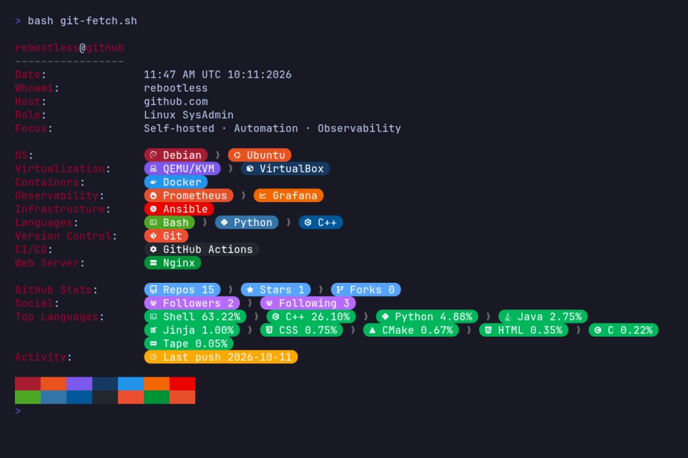

<p align="center">
  
</p>

<!--
```
rebootless@github
–––––––––––––––––
Date:
Whoami:             rebootless
Host:               github.com
Role:               Linux SysAdmin
Focus:              Self-hosted · Automation · Observability
                                                                                                                                                                                                                                               
OS:                  Debian ❯  Ubuntu
Virtualization:      QEMU/KVM ❯  VirtualBox
Containers:          Docker
Observability:       Prometheus ❯  Grafana
Infrastructure:     󱂚 Ansible
Languages:           Bash ❯  Python ❯  C++
Version Control:     Git
CI/CD:               GitHub Actions
Web Server:          Nginx

GitHub Stats:
Social:
Top Languages:
Activity:
```
-->
