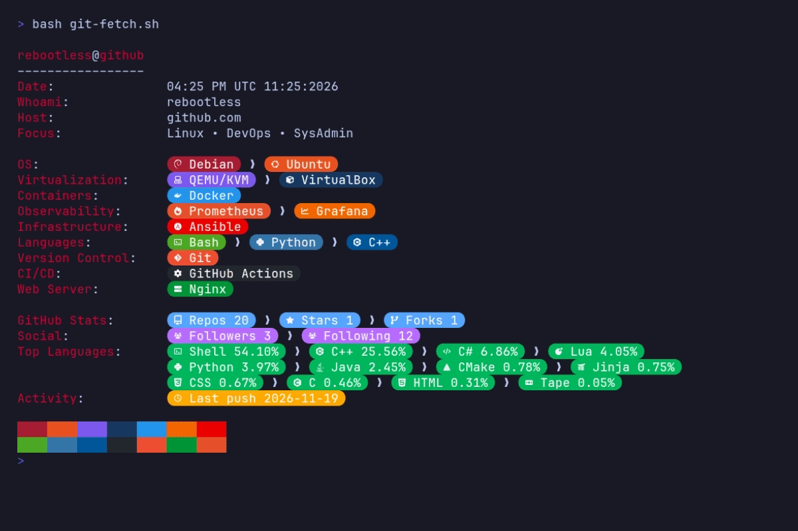

<p align="center">
  
</p>

<!--
```
rebootless@github
–––––––––––––––––
Date:
Whoami:             rebootless
Host:               github.com
Focus:              Linux • DevOps • SysAdmin
                                                                                                                                                                                                                                               
OS:                  Debian ❯  Ubuntu
Virtualization:      QEMU/KVM ❯  VirtualBox
Containers:          Docker
Observability:       Prometheus ❯  Grafana
Infrastructure:     󱂚 Ansible
Languages:           Bash ❯  Python ❯  C++
Version Control:     Git
CI/CD:               GitHub Actions
Web Server:          Nginx

GitHub Stats:
Social:
Top Languages:
Activity:
```
-->

<details>
<summary align="center"><b>More...</b> <i>(click to expand)</i></summary>
<br>

Check out my [GitHub Gists](https://gist.github.com/rebootless)

</details>
